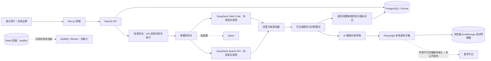

# GeoLens 演示素材包

执行日期：2026-10-24（Asia/Shanghai）；数据：合成品牌“示例咖啡”；真实 DeepSeek Provider（`deepseek-flash`）。

## 演示结果

从品牌输入到第二轮检索已端到端完成。DeepSeek 对话与 Search API 均有真实调用；共生成 11 条监测问题，每轮检测均为 COMPLETED、返回 11/11 条回答，并保存 33 条检索来源。首轮指标：品牌提及率 27.27%（3/11），通用发现 0/8，品牌相关问题 3/3（100%），实时检索覆盖率 11/11（100%）；报告列出 8 条机会，诊断页生成 3 条建议。第二轮使用同一问题集，指标仍为 27.27%、0/8、3/3 和 11/11；这只能说明重跑完成，不能说明内容发布带来可见度提升。

发布演示只在本地模拟发布页面操作：1 条草稿写入浏览器 localStorage，外部 POST 请求为 0，未登录或发布到任何外部平台。没有配置真实平台连接器。

## 服务健康

| 组件 | 状态 | 检查结果 |
| --- | --- | --- |
| Next.js 前端 | 健康 | `http://localhost:3000` 返回 HTTP 200 |
| NestJS API | 健康 | `/health` 返回 `ok` |
| PostgreSQL | 健康 | `/health/db` 返回 `connected`，Prisma migration 已应用 |
| Redis | 容器健康 | Docker 容器 healthy；当前应用没有连接它 |
| BullMQ / Worker | 未接入 | 检测由 API 进程内异步执行，没有独立队列或 Worker |

## 截图说明

Playwright 页面视口为 1440×900；全页或局部截图保留其原始尺寸，例如问题集为 1440×3093、回答与来源为 1062×2307、草稿为 1440×2957。文件位于 `demo-screenshots/live-deepseek/`。

| 文件 | 说明 |
| --- | --- |
| [01-input.png](demo-screenshots/live-deepseek/01-input.png) | 输入合成品牌“示例咖啡”、咖啡与饮品行业及示例竞品；Next.js 表单调用 NestJS API 创建项目和品牌记录。 |
| [02-questions.png](demo-screenshots/live-deepseek/02-questions.png) | 展示真实 DeepSeek Provider 生成并保存的 11 条问题；模型网关生成问题后将 Query Set 保存到项目。 |
| [03-monitor-progress.png](demo-screenshots/live-deepseek/03-monitor-progress.png) | 截取检测刚启动时的进度卡片（0/11）；前端读取 NestJS 任务状态，检测由 API 进程内异步执行。 |
| [04-real-answer-and-source.png](demo-screenshots/live-deepseek/04-real-answer-and-source.png) | 展示 DeepSeek Flash 的真实回答、响应耗时和检索来源；调用 DeepSeek Chat 与 Search API，并保存回答证据。 |
| [05-report-overview.png](demo-screenshots/live-deepseek/05-report-overview.png) | 打开真实检测报告总览；NestJS 从 PostgreSQL 读取逐题回答与来源，聚合为项目报告。 |
| [06-report-metrics.png](demo-screenshots/live-deepseek/06-report-metrics.png) | 展示 27.27% 品牌提及率、0/8 通用发现、3/3 品牌相关问题和 11/11 检索覆盖率；指标从本轮 11 条回答计算。 |
| [07-report-diagnosis.png](demo-screenshots/live-deepseek/07-report-diagnosis.png) | 展示真实 Provider 生成的 3 条诊断建议；每条建议关联监测问题与回答证据，供人工复核。 |
| [08-content-draft.png](demo-screenshots/live-deepseek/08-content-draft.png) | 展示基于报告建议生成的标题、摘要、正文和风险核对项；内容由 DeepSeek 生成并保存为 GeoLens 草稿。 |
| [09-publish-preview.png](demo-screenshots/live-deepseek/09-publish-preview.png) | 选择官网文章草稿并进入发布步骤；NestJS 创建待人工复核的分发任务，不会自动公开发布。 |
| [10-publish-content-and-action.png](demo-screenshots/live-deepseek/10-publish-content-and-action.png) | Playwright 打开本地模拟发布页，展示待保存的真实生成内容及“保存到本地测试草稿箱”动作；页面不连接外部平台。 |
| [11-publish-action-saved.png](demo-screenshots/live-deepseek/11-publish-action-saved.png) | 展示本地草稿保存成功状态；Playwright 核验 localStorage 中有 1 条草稿、外部 POST 请求数为 0。 |
| [12-before-after.png](demo-screenshots/live-deepseek/12-before-after.png) | 并排对比两轮真实检索指标；问题集相同且数字未变，页面注明不能据此推断内容带来因果提升。 |

## 录屏

[demo.mp4](demo.mp4) 为 Playwright 录制的完整流程，分辨率 1440×900、25 fps、时长约 2 分 53 秒。视频以 1.25 倍速播放完整录制画面；从品牌输入开始，经过问题生成、真实检索、报告、草稿、本地测试草稿箱保存和第二轮检索对比。录屏不包含外部平台登录或公开发布动作，也没有音轨。

## 系统架构

## 跑通过程中处理的问题

| 问题 | 原因 | 修复或处理 |
| --- | --- | --- |
| 数据库健康检查最初不通 | 本机 `.env` 中 PostgreSQL 端口与 Docker 暴露端口不一致 | 将本地连接端口改为当前映射端口并重启 API；没有读取或输出凭据。 |
| 快速开始迁移未应用 | Prisma 检测到待应用的 quick-start migration | 使用仓库已有 deploy 脚本应用迁移，并确认 schema 已同步。 |
| 部分 DeepSeek 回答输出被截断 | 长问题集下答案生成长度超过原 token 上限 | 提高回答 token 上限、缩短回答要求并重跑；最终每轮 11/11 完成。 |
| 诊断建议输出不完整或草稿可选字段缺失 | 模型输出长度和可选 JSON 字段存在波动 | 缩短建议输出，并对摘要、标签、元数据等可选字段补充解析默认值。 |
| Playwright 找不到“继续生成内容”按钮 | 箭头图标设为 `aria-hidden`，不是按钮的无障碍名称 | 按按钮实际可访问名称定位；对完成步骤使用可匹配带完成标记的名称。 |
| Next.js / NestJS 报端口占用 | 调试时重复启动了 API watch 进程 | 结束重复的本地开发进程后，通过仓库根目录 `pnpm dev` 单次启动并确认服务健康。 |

## 尚未跑通或风险

- 本次只验证了 DeepSeek；Qwen 尚未配置，也未实测。
- Redis 容器健康，但应用没有连接 Redis；BullMQ 队列和独立 Worker 尚未接入。API 进程重启时，进程内任务没有持久化重试保障。
- 发布流程只连接本地模拟页面并保存到浏览器 localStorage；外部平台适配器、账号授权和真实发布均未实现。
- 第二轮指标与首轮相同。演示证明了真实模型检索及重复采样流程可运行，尚不能证明发布内容带来真实可见度变化。
- 报告指标基于本次 11 条问题样本，不能直接代表长期排名或全部用户查询表现。

## 简历 / README 项目介绍（200 字以内）

GeoLens 是品牌 GEO 监测平台，覆盖 AI 问题生成、DeepSeek Chat/Search 实时采样、来源证据、可见度指标、诊断和内容草稿。系统使用 Next.js、NestJS、Prisma/PostgreSQL，检测任务由 API 进程内异步执行；发布演示仅写入本机测试草稿箱，BullMQ Worker 和外部平台连接器尚未接入。
