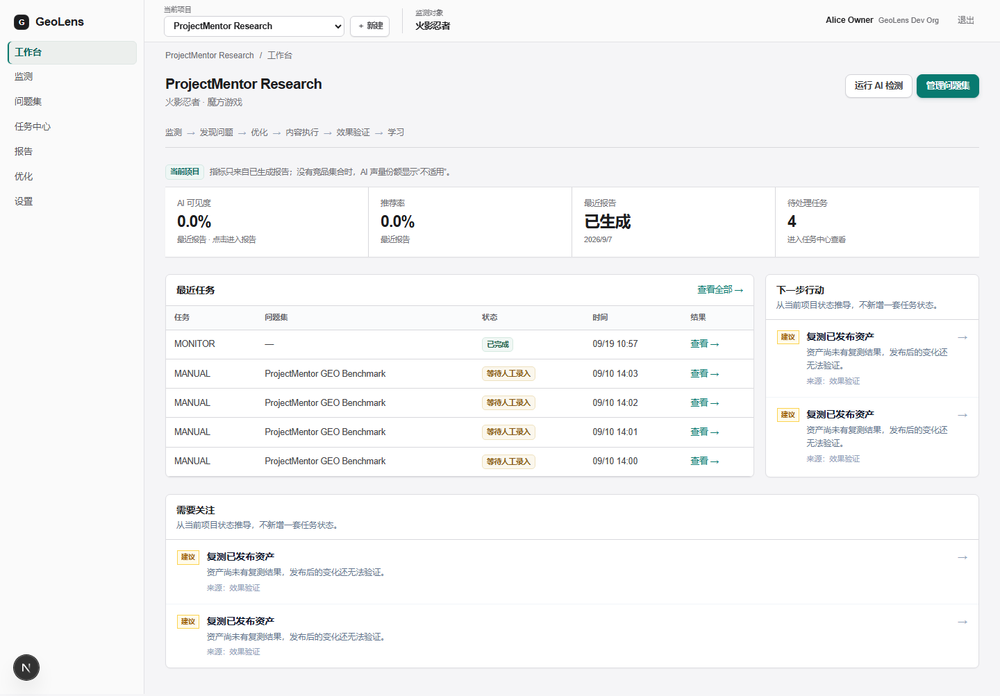

# GeoLens (everyone-geo)

Local workbench for **generative engine optimization (GEO)**: track how AI answers mention a brand, keep the raw response, and turn that evidence into drafts. It is a TypeScript monorepo (Next.js, NestJS, Prisma, BullMQ). It is not a hosted multi-channel poster, and it does not ship lift numbers.

[中文能力边界](#capability-boundary) · [Run the demo](#run-the-demo) · [Longer docs](#docs)



## What it does

```
apps/web (Next.js 15)  →  apps/api (NestJS 11)  →  PostgreSQL 17
                              │
                              ▼
                         Redis + BullMQ  →  apps/worker
                              │
              monitor runs: mock LLM, or DeepSeek / Qwen when enabled
              publications: MockPublicationPublisher unless you opt in
```

| Path | What actually runs |
| --- | --- |
| Monitoring | Question sets, runs, and immutable raw evidence. Real model calls stay off until `ENABLE_REAL_PROVIDERS=true` and a server-side key is set. The default demo uses the mock engine. |
| Reports | Visibility, share of voice, recommendation, position, and citation are computed from stored runs. They are observations, not a promised lift. |
| Content | Drafts, approval, and local revision history. |
| Publication | Redis and the BullMQ worker are wired. The shared `executePublication` path still uses `MockPublicationPublisher`. Successful demo publishes store `mock_` ids and `https://mock.geo.local/...` URLs. Nothing is posted to WordPress, WeChat, or other channels. |
| Browser assist | Several social channels stop at **PREPARE_ONLY**: a controlled browser can fill a form, and a person confirms before any public submit. Others export a local manual package. |

<a id="capability-boundary"></a>

**能力边界（与代码一致）**

- 默认 `PUBLICATION_MODE=mock`。创建发布会走 `packages/queue` 的 `executePublication` → `MockPublicationPublisher`。Worker 消费的是同一条路径，所以队列在跑也不等于已经外发。
- `PUBLICATION_MODE=real`（或未设置该变量时的旧开关 `EXTERNAL_PUBLISHING_ENABLED=true`）才允许 `PublicationRouter` 调用连接器的 `doPublish`。即便如此，演示 API / worker 共用的 `executePublication` **不会**假装发布成功，失败码是 `REAL_PUBLICATION_NOT_WIRED`。
- 微信连接器在 real 模式下只调用草稿箱接口，不群发。WordPress 连接器可以按调用方传入的 `targetStatus` 写草稿或文章，但本地 demo 按钮不走这条出站路径。
- 小红书、视频号、知乎等没有被当成已开通的自动发帖。界面上的浏览器辅助明确停在 PREPARE_ONLY，由人确认。

Channel code and the credential matrix: [docs/connectors/CONNECTOR_MATRIX.md](docs/connectors/CONNECTOR_MATRIX.md). That file describes connectors, not a default live integration.

## Run the demo

Same commands on macOS, Linux, and Windows (PowerShell, Git Bash, or WSL). Node **24** (CI and `package.json` engines), pnpm 10+, Docker.

```bash
git clone https://github.com/tahffo68hk-hash/everyone-geo.git
cd everyone-geo
pnpm install
cp .env.example .env
docker compose up -d
pnpm --filter @geo/database migrate
pnpm --filter @geo/database db:seed
pnpm dev
```

Leave `PUBLICATION_MODE=mock` and `ENABLE_REAL_PROVIDERS=false` in `.env` for the local demo. Do not commit `.env`.

| Surface | URL |
| --- | --- |
| Workbench | http://localhost:3000/app |
| Dev status | http://localhost:3000/dev/status |
| API docs | http://localhost:3001/docs |

Seed login (local database only): `alice@geolens.local` / `Password123!`

Windows can also use `START_GEOLENS.cmd`, `STATUS_GEOLENS.cmd`, and `STOP_GEOLENS.cmd`. Those call `scripts/dev-control.ps1` and are Windows-only. They are a shortcut around the same Docker + `pnpm dev` flow, not a different product.

### Publication switch

| `PUBLICATION_MODE` | Behavior |
| --- | --- |
| `mock` (default) | Sandbox only. `mock_` ids, `https://mock.geo.local/...`. |
| `real` | Connector `doPublish` may run from `PublicationRouter` when credentials exist. `executePublication` fails closed instead of writing a fake live URL. |
| unset | `EXTERNAL_PUBLISHING_ENABLED=true` is the old way to select `real`. Any other value stays `mock`. |

Copy the rest of the variables from [.env.example](.env.example). LLM keys are optional and server-side.

### Checks

```bash
pnpm --filter @geo/queue test
pnpm test:unit
pnpm typecheck
pnpm lint
```

CI runs `pnpm typecheck` and `pnpm lint` with no `|| true`. Typecheck is `tsc --noEmit` in each package. Root `pnpm lint` runs `next lint` in `apps/web` (`next/core-web-vitals`).

## Docs

Longer material lives under [docs/](docs/), not in this file:

- [Architecture](docs/ARCHITECTURE.md)
- [User guide](docs/USER_GUIDE.md) (Chinese)
- [Database](docs/DATABASE.md)
- [Queue and worker](docs/QUEUE.md)
- [LLM providers](docs/LLM_PROVIDERS.md)
- [GEO metric definitions](docs/GEO_METRICS.md)
- [Connector matrix](docs/connectors/CONNECTOR_MATRIX.md)
- [Development workflow](docs/DEVELOPMENT_WORKFLOW.md)

UI captures: [docs/images/](docs/images/).

## License

[MIT](LICENSE)
