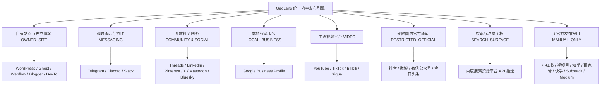

# 社交与内容平台 Connector 接入官方决策白皮书

> **基准日期**：2026-09-15  
> **适用范围**：GeoLens 全渠道连接与内容分发平台 (Multi-Channel Connector Platform)  
> **核心原则**：**坚持 100% 官方可信开放接口，严守合规安全防线，杜绝任何爬虫、Cookie 伪造与逆向脚本**  

---

## 1. 战略背景与核心准则

在 AI 生成内容（AIGC）与生成式引擎优化（GEO）高速普及的当下，各类社交媒体与内容平台对非官方自动化请求的风控力度达到了历史最高水平。

作为面向企业客户的高净值 GEO 平台，GeoLens 的核心资产是客户的品牌信任与搜索可见性排名。任何导致客户主账号被封禁、降权、拉黑的操作，都将对品牌造成不可挽回的信誉与商业损失。

因此，GeoLens 制定如下铁律：
1. **官方正规军原则**：仅对接平台公开、官方认可且允许第三方 SaaS 调用的开发者开放 API（REST / GraphQL / OAuth2 / Webhook）；
2. **零黑产与零灰色工具**：绝对不采用任何注入式 Cookie、无头浏览器模拟登录、手机农场自动化挂机或逆向未公开私有 API；
3. **真实分类治理**：对于存在官方 API 的渠道实现端到端自动化；对于官方不开放发文能力的渠道，通过 `ManualPublishingPackage`（手工发布物料包）赋能运营人员，实现高效、合规的“人机协同”。

---

## 2. 平台类型全景分类矩阵

我们将当前纳入版图的 30+ 主流渠道划分为以下八大战略形态：

### 2.1 自动化就绪型平台 (READY / READY_FOR_CREDENTIALS)
- **代表渠道**：WordPress、Ghost、Webflow、Telegram、Discord、Slack、Mastodon、Bluesky、Reddit、Threads、LinkedIn、Pinterest、X、Google Business Profile、YouTube、Baidu Search Surface。
- **技术实现**：具备成熟的 OAuth 2.0 / Personal Access Token / API Key / Webhook 机制。GeoLens 完成了完整的连接器适配，支持自动化内容校验、媒体上传、正文发布与状态查询。

### 2.2 资质受限与企业审核型平台 (REQUIRES_APP_REVIEW / RESTRICTED)
- **代表渠道**：抖音 (Douyin)、微博 (Weibo)、微信公众号 (WeChat Official Account)、今日头条 (Toutiao)、TikTok、Instagram、Facebook。
- **技术现状**：官方具备服务端发布能力，但要求开发者或品牌拥有企业资质认证、ICP 备案、甚至特定行业白名单（如抖音代投稿下线、仅直发）。
- **处理策略**：GeoLens 提供标准化连接鉴权通道与状态流转机，当客户凭证尚未获批高级发布权限时，系统以 `REQUIRES_APP_REVIEW` 状态友好提示，并在写闸门下保持确定性安全发布与 Mock 追踪。

### 2.3 官方无第三方代发 API 平台 (MANUAL_ONLY)
- **代表渠道**：小红书 (Xiaohongshu)、微信视频号 (WeChat Channels)、知乎 (Zhihu)、百家号 (Baijiahao)、快手 (Kuaishou)、Substack、Medium。
- **技术现状**：官方未向第三方 SaaS 开放服务端笔记/文章自动化发布接口，仅支持网页端人工发布或移动端 App 剪辑页唤醒。
- **处理策略**：系统自动识别并拒绝自动化出站网络请求，秒级生成包含标题、排版正文、话题标签、素材下载清单、发布前合规自查表的 `ManualPublishingPackage`，保障运营发布效率与账号绝对安全。

---

## 3. 核心安全机制与发布保障

### 3.1 凭据安全金库 (`CredentialVault`)
- 采用 **AES-256-GCM** 高强度对称加密；
- 密钥库引用采用不透明 URI 格式（如 `vault://aes256gcm/wordpress/7d3a...`）；
- 任何 API 接口、数据库明文查询、系统审计日志与前端响应均对 `accessToken`、`apiKey`、`clientSecret` 强制脱敏与隐藏。

### 3.2 OAuth State 防篡改安全 (`OAuthStateSecurity`)
- 授权 State 携带 HMAC-SHA256 签名，有效防范 CSRF 与篡改；
- 包含 10 分钟严格失效窗口，并与特定的 `organizationId`、`projectId` 及 `channel` 强绑定，严防跨租户投毒攻击。

### 3.3 出站写安全闸门 (`OutboundWriteGuard`)
- 全局受控于环境变量 `EXTERNAL_PUBLISHING_ENABLED`；
- 在环境变量非 `"true"` 的环境下，发布链路对任何外部真实 API 执行硬拦截；
- 统一生成标准确定性的 `https://mock.geo.local/${channel}/${externalId}`，保障 e2e 测试、预发环境演练与演示安全无害。

### 3.4 严格的幂等性与审批状态机
- 内容必须经历 `DRAFT -> READY_FOR_REVIEW -> APPROVED`，只有获得 `APPROVED` 审批的最新版本草稿才具备发布资格；
- 每次发布动作绑定全局唯一 `idempotencyKey`，相同幂等键的重放请求零外部网络开销、不重复生成发布记录，确保高并发下的系统确定性。
