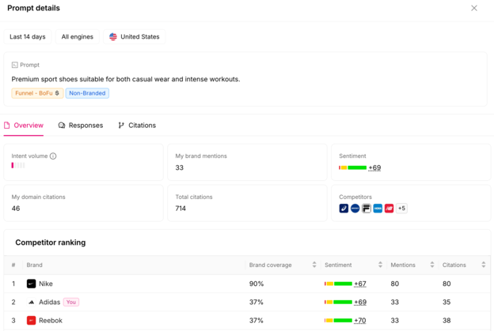

# 公共页面图像与截图说明

研究日期：2026-10-16。以下均为公开官网/帮助中心可访问的图像素材，原图保持来源。除 Otterly help-center 截图可能来自产品文档外，营销图片/演示界面都按“示意材料”处理，**不代表本研究已登录产品或验证页面实时数据**。

| 文件 | 产品/内容 | 类型和证据状态 | 来源 |
|---|---|---|---|
| [otterly-prompt-monitoring.png](otterly-prompt-monitoring.png) | Prompt Monitoring 表格/趋势 | 官方帮助中心 UI 截图；DOCUMENTED 示例，不是本次登录实测 | [Otterly screenshot](https://help.otterly.ai/hs-fs/hubfs/OtterlyAI%202026-10-05%2011-18-05.png?height=551&name=OtterlyAI+2026-10-05+11-18-05.png&width=670) |
| [otterly-prompt-detail-overview.png](otterly-prompt-detail-overview.png) | Prompt Detail overview | 官方帮助中心 UI 截图；DOCUMENTED 示例 | [Otterly screenshot](https://help.otterly.ai/hs-fs/hubfs/Screenshot%20%2814%29.png?height=419&name=Screenshot+%2814%29.png&width=624) |
| [otterly-answer-evidence.png](otterly-answer-evidence.png) | Answer evidence / response detail | 官方帮助中心 UI 截图；DOCUMENTED 示例 | [Otterly screenshot](https://help.otterly.ai/hs-fs/hubfs/Screenshot%20%2816%29.png?height=458&name=Screenshot+%2816%29.png&width=670) |
| [otterly-citations.png](otterly-citations.png) | Citation 页面 | 官方帮助中心 UI 截图；DOCUMENTED 示例 | [Otterly screenshot](https://help.otterly.ai/hs-fs/hubfs/Screenshot%20%281%29-Jul-22-2026-11-52-07-1522-AM.png?height=321&name=Screenshot+%281%29-Jul-22-2026-11-52-07-1522-AM.png&width=670) |
| [peec-home.png](peec-home.png) | Peec 官网首页及嵌入式 dashboard 演示 | 本次浏览器实际看到的公开页面截图（VERIFIED）；产品区为演示数据 | [Peec homepage](https://peec.ai/) |
| [peec-marketing-dashboard.webp](peec-marketing-dashboard.webp) | 品牌竞品表，Visibility/Sentiment/Position | Peec 官网演示图；营销示例数据 | [Peec homepage](https://peec.ai/) |
| [ahrefs-brand-radar-ai-visibility.png](ahrefs-brand-radar-ai-visibility.png) | AI Share of Voice、Search Demand、Web/YouTube visibility 及趋势 | Ahrefs 官网公开静态 UI 样例；营销示意，不是客户数据 | [Ahrefs image asset](https://ahrefs.com/assets/esbuild/ai-visibility-5OHJ3NGT.png) |
| [airops-visibility-tracking.avif](airops-visibility-tracking.avif) | AirOps AI Search visibility 页面资产 | 官网公开 AVIF 素材；无法在当前图片预览器解码，保留原文件供兼容浏览器查看 | [AirOps visibility page](https://www.airops.com/ai-search-visibility) |

本目录没有直接截取登录后的竞品产品。用户的浏览器中可访问的公开页面只用于查看公开内容；没有进入账号或绕过权限。

## 页面预览

Peec 公共官网和内嵌演示：

Otterly 官方帮助中心中的 Prompt 详情示意：

